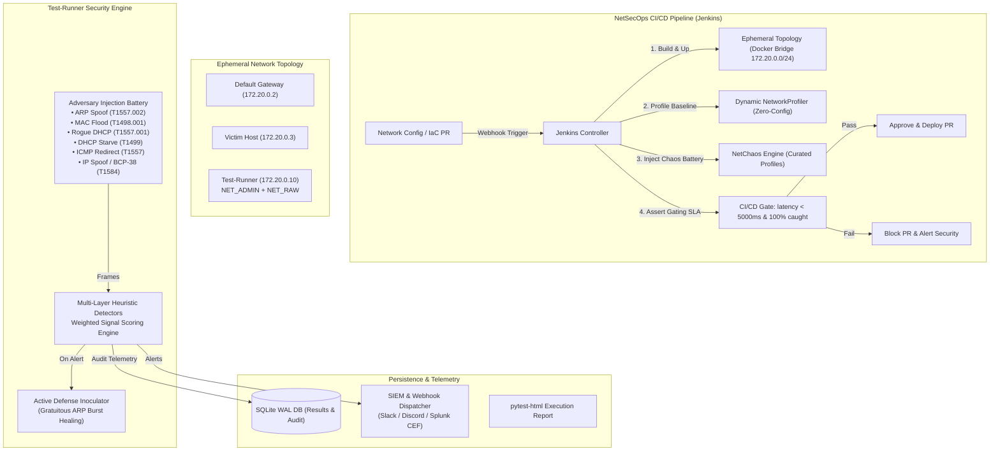

# NetChaos: Autonomous L2/L3 Network Security Chaos & CI/CD Gating Engine

An enterprise-grade **NetSecOps Chaos Engineering Platform** that simulates sophisticated Layer 2 and Layer 3 network attacks (ARP poisoning, CAM table exhaustion, Rogue DHCP, DHCP pool starvation, ICMP route redirection, and BCP-38 IP spoofing) inside disposable network topologies, detects them using a **multi-layered heuristic detection engine**, actively neutralizes threats via **automated Gratuitous ARP (GARP) inoculation**, and validates network switch resilience through automated CI/CD gating in Jenkins.

---

## 1. Executive Summary & Problem Statement

### The "Layer 2 / Data-Link Blind Spot"
Enterprise security teams invest heavily in Host-layer EDR (CrowdStrike, Defender) and Perimeter Firewalls (Palo Alto, Cloudflare). However:
* **EDR agents do not monitor raw ethernet switch frames.**
* **Firewalls only inspect routed traffic traversing subnets**, leaving traffic *within* the same switch/VLAN completely uninspected.
* In enterprise switches (Cisco, Arista, Juniper), security features like **Dynamic ARP Inspection (DAI)**, **DHCP Snooping**, and **Port Security** are configured via Infrastructure as Code (Ansible, Terraform).
* **The Failure**: A routine firmware update or VLAN configuration push can silently break DHCP snooping or DAI. Traditional CI/CD pipelines have no way to regression-test physical or virtual network policies.

### The Solution: Network Chaos Engineering (NetSecOps)
NetChaos introduces automated **Security Chaos Engineering** to the network layer:
1. Every time a network configuration or switch rule change is proposed in Git, Jenkins provisions an isolated ephemeral network topology.
2. NetChaos executes curated chaos drills across 6 attack vectors.
3. If an attack bypasses switch boundaries or exceeds a **<5000ms detection latency SLA**, NetChaos **fails the build and blocks the deployment**.

---

## 2. Architecture & Subsystems



---

## 3. Attack & Detection Matrix (MITRE ATT&CK & PCI-DSS 4.0)

| Layer | Attack Vector | Module | Heuristic Layers | MITRE ATT&CK | PCI-DSS 4.0 Spec | Active Defense |
|---|---|---|---|---|---|---|
| **L2** | **ARP Poisoning (MitM)** | `attacks/arp_spoof.py` | L1: Binding Change<br/>L2: Unsolicited Reply<br/>L3: Header Mismatch<br/>L4: Reply Spike | `T1557.002` (Adversary-in-the-Middle) | Req 1.3 & 11.2 | **GARP Inoculation** (5x healing frames) |
| **L2** | **CAM Table Exhaustion** | `attacks/mac_flood.py` | L1: Unique MAC Rate<br/>L2: OUI Manufacturer<br/>L3: MAC Churn Velocity<br/>L4: Adaptive Baseline | `T1498.001` (Direct Network Flood) | Req 1.4 & 10.4 | Telemetry alert to SIEM |
| **L2** | **Rogue DHCP Server** | `attacks/rogue_dhcp.py` | L1: Untrusted Server<br/>L2: Duplicate Offer<br/>L3: Parameter Anomaly<br/>L4: Option Fingerprint | `T1557.001` (DHCP Spoofing) | Req 1.3 & 11.2 | Telemetry alert to SIEM |
| **L2** | **DHCP Pool Starvation** | `attacks/dhcp_starvation.py` | L1: Discover Rate Spike<br/>L2: Unique CHADDR Velocity<br/>L3: Payload/Header Mismatch<br/>L4: XID Anomaly | `T1499` (Endpoint Denial of Service) | Req 1.4 & 10.4 | Telemetry alert to SIEM |
| **L3** | **ICMP Route Redirection** | `attacks/icmp_redirect.py` | L1: Untrusted Sender<br/>L2: Unauthorized Router<br/>L3: Redirect Burst<br/>L4: On-Link Violation | `T1557` (Adversary-in-the-Middle) | Req 1.3 & 11.2 | Telemetry alert to SIEM |
| **L3** | **IP Spoofing (BCP-38)** | `attacks/ip_spoof.py` | L1: Bogon/Martian IP<br/>L2: Ingress Boundary<br/>L3: MAC-IP Conflict<br/>L4: Ingress Flow Burst | `T1584` (Defense Evasion / Spoofing) | Req 1.3 (Boundary Controls) | Telemetry alert to SIEM |

---

## 4. Active Defense & Inoculation (Automated ARP Healing)

Unlike passive IDS tools that merely log an alert while traffic is intercepted, NetChaos includes an **Active Defense Inoculation Engine** (`defense/arp_healer.py`):

1. When `ARPDetector` detects that an endpoint's MAC binding has been poisoned, it immediately invokes `ARPCacheHealer`.
2. The healer crafts authoritative **Gratuitous ARP (GARP) reply frames** (`op=2, hwsrc=authoritative_mac`).
3. It broadcasts a rapid burst (5 frames) across the broadcast domain.
4. All listening switch CAM tables and victim host caches instantly overwrite the attacker's poisoned entry, **neutralizing the MitM attempt before data exfiltration occurs**.

---

## 5. Unified CLI Usage (`netchaos`)

NetChaos includes a unified command-line tool for standalone verification, chaos drills, and CI/CD gating:

```bash
# 1. List available curated chaos profiles
python netchaos.py list-profiles

# 2. Run the dynamic network discovery to establish an authoritative baseline
python netchaos.py profile --export baseline.json

# 3. Run a curated chaos scenario (smoke, insider-threat, dos-stress, compliance-audit)
python netchaos.py run --profile compliance-audit --active-defense

# 4. CI/CD Gating (returns exit code 0 if all attacks detected within SLA, 1 on failure)
python netchaos.py gate --profile compliance-audit

# 5. Query historical SQLite compliance audit records
python netchaos.py report --limit 10
```

---

## 6. Curated Chaos Profiles

* **`smoke`**: Fast pre-flight sanity check (ARP spoof + BCP-38 IP boundary check). SLA: `<2500ms`.
* **`insider-threat`**: Simulates a physical rogue implant (e.g. LAN Turtle under a desk) executing Rogue DHCP, ARP poisoning, and ICMP redirects. SLA: `<3000ms`, Active Defense required.
* **`dos-stress`**: High-volume stress testing verifying that switch CAM tables and DHCP Snooping rate limits prevent pool exhaustion. SLA: `<5000ms`.
* **`compliance-audit`**: Complete battery across all 6 attack vectors for PCI-DSS 4.0 certification. SLA: `<5000ms`, Active Defense required.

---

## 7. Running the Test Suite

```bash
# Run complete test suite (16 tests across all 3 phases)
pytest tests/test_phase1_defense.py tests/test_phase2_l2_l3.py tests/test_phase3_cli_and_telemetry.py

# Run standalone end-to-end demonstration
python demo.py
```

---

## 8. Jenkins CI/CD Integration

The provided `Jenkinsfile` orchestrates the complete NetSecOps workflow:
* Spins up the ephemeral Docker network (`gateway`, `victim`, `test-runner`).
* Dynamically profiles the network baseline.
* Injects the curated NetChaos attack battery.
* Evaluates the Quality Gate (`netchaos.py gate --profile compliance-audit`).
* Publishes HTML reports and exports the SQLite audit trail.
* Tears down the ephemeral topology upon completion.
