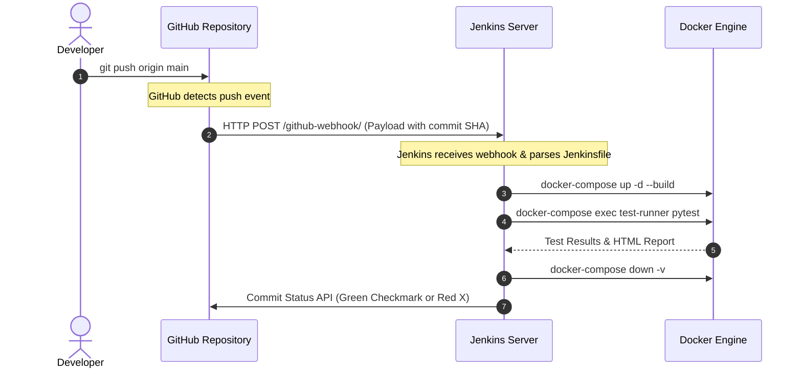

# L2 Network Security Simulation, Docker, Jenkins & CI/CD Master Guide

A comprehensive practical guide covering:
1. **Interactive Multi-Container L2 Attack Simulation (Side-by-Side Terminals)**
2. **Docker & Docker Compose Complete Command Reference**
3. **Jenkins Architecture, Pipeline Syntax & Commands**
4. **GitHub to Jenkins CI/CD Integration & Git Command Reference**

---

## 1. Interactive Multi-Container Simulation (Side-by-Side)

### 1.1 Terminal Setup Layout
Open **3 terminal windows or split panes**:

```
┌──────────────────────────────┬──────────────────────────────┬──────────────────────────────┐
│     TERMINAL 1: GATEWAY      │     TERMINAL 2: VICTIM       │   TERMINAL 3: TEST-RUNNER    │
│       (172.20.0.2)           │       (172.20.0.3)           │       (172.20.0.10)          │
│   02:42:ac:14:00:02          │   02:42:ac:14:00:03          │   02:42:ac:14:00:0a          │
└──────────────────────────────┴──────────────────────────────┴──────────────────────────────┘
```

### 1.2 Step-by-Step Terminal Execution

#### 🪟 Step 1: Start the Topology
In your main terminal on the host machine:
```powershell
docker-compose -f docker/docker-compose.yml up -d
```

---

#### 🪟 Step 2: Open Terminal 1 — Gateway Router (`172.20.0.2`)
```powershell
docker exec -it l2-gateway bash
```
Inside the container, run a live packet capture to monitor incoming traffic:
```bash
# Verify IP and MAC configuration
ip addr show eth0

# Watch live network traffic filtered by ARP and DHCP
tcpdump -i eth0 -n -e arp or port 67 or port 68
```

---

#### 🪟 Step 3: Open Terminal 2 — Victim Host (`172.20.0.3`)
```powershell
docker exec -it l2-victim bash
```
Inside the container, observe the victim's ARP cache and incoming frames:
```bash
# Verify initial ARP cache (gateway IP should map to 02:42:ac:14:00:02)
arp -n

# Watch live packet traffic
tcpdump -i eth0 -n -e
```

---

#### 🪟 Step 4: Open Terminal 3 — Attacker & Test Runner (`172.20.0.10`)
```powershell
docker exec -it l2-test-runner bash
```
From this terminal, test connectivity and trigger live attack scenarios:

##### A. Ping Connectivity Check
```bash
ping -c 3 172.20.0.2   # Gateway
ping -c 3 172.20.0.3   # Victim
```

##### B. Attack Simulation 1: ARP Spoofing (MITM Poisoning)
```bash
# Send 10 spoofed ARP replies claiming Gateway 172.20.0.2 is at Attacker MAC (02:42:ac:14:00:0a)
python -c "from attacks.arp_spoof import ARPSpoof; ARPSpoof(target_ip='172.20.0.3', gateway_ip='172.20.0.2').launch(count=10, interval=0.2)"
```
> **What to observe:** Look at **Terminal 2 (Victim)**. The `tcpdump` window will show ARP replies arriving, and running `arp -n` will show the Gateway's MAC address has been poisoned and changed to `02:42:ac:14:00:0a`.

##### C. Attack Simulation 2: MAC Flooding (CAM Table Overflow)
```bash
# Send 300 Ethernet frames with randomized source MACs
python -c "from attacks.mac_flood import MACFlood; MACFlood().launch(count=300, interval=0.005)"
```
> **What to observe:** Look at **Terminal 1 & Terminal 2**. Both terminals' `tcpdump` streams will instantly flood with hundreds of frames with random source MAC addresses.

##### D. Attack Simulation 3: Rogue DHCP Server (Gateway Hijacking)
```bash
# Send forged DHCP OFFER advertising Attacker as Router & DNS
python -c "from attacks.rogue_dhcp import RogueDHCP; RogueDHCP(attacker_ip='172.20.0.10').launch(count=5, interval=0.3)"
```
> **What to observe:** In **Terminal 1 (Gateway)**, `tcpdump` will capture the rogue DHCP OFFER frame attempting to hijack the victim's gateway configuration.

##### E. Run the Full Automated Detection Suite
```bash
# Run pytest automated validation
pytest -v

# Inspect the SQLite database test results
python -c "from common.db import get_results; [print(f\"[{r['attack_type']}] Detected={bool(r['detected'])}, Score={r['total_score']}, Latency={r['response_time_ms']:.2f}ms, Signals={r['signals_fired']}\") for r in get_results('/app/db/results.db')]"
```

---

## 2. Docker & Docker Compose Complete Guide

### 2.1 Core Concepts
* **Image**: A read-only blueprint containing the OS, runtime, and application code (e.g. `Dockerfile.test-runner`).
* **Container**: A running, isolated instance of an image.
* **Bridge Network**: A software switch inside Docker allowing containers on the same subnet to communicate via IP and MAC.
* **Volume**: Persistent or host-mounted storage mapped into a container (`-v .:/app`).
* **Capabilities (`cap_add`)**: Linux security privileges granted to containers (e.g. `NET_ADMIN` for route changes, `NET_RAW` for raw sockets).

### 2.2 Essential Docker Commands Reference

#### Container Lifecycle
```bash
# List active running containers
docker ps

# List all containers (including stopped)
docker ps -a

# Start a container in background
docker run -d --name my-container <image_name>

# Stop a running container gracefully
docker stop <container_name_or_id>

# Force kill a container
docker kill <container_name_or_id>

# Restart a container
docker restart <container_name_or_id>

# Remove a stopped container
docker rm <container_name_or_id>

# Force remove a running container
docker rm -f <container_name_or_id>
```

#### Exec & Inspection
```bash
# Open an interactive Bash shell inside a running container
docker exec -it <container_name> bash

# Run a single command inside container without opening a shell
docker exec <container_name> ping -c 3 172.20.0.2

# View real-time container output logs
docker logs -f <container_name>

# View low-level container details (IP, MAC, mounts, environment)
docker inspect <container_name>

# View resource usage (CPU, Memory, Network I/O)
docker stats
```

#### Image Management
```bash
# Build an image from a Dockerfile in the current directory
docker build -t my-app:latest .

# List local images
docker images

# Remove an image
docker rmi <image_id_or_name>

# Prune unused images and build cache
docker image prune -a
```

#### Docker Compose Commands
```bash
# Build and start all services in background
docker-compose -f docker/docker-compose.yml up -d --build

# View status of compose services
docker-compose -f docker/docker-compose.yml ps

# View aggregate logs of all services
docker-compose -f docker/docker-compose.yml logs -f

# Run a command inside a compose service
docker-compose -f docker/docker-compose.yml exec test-runner pytest -v

# Stop and remove all containers, networks, and volumes
docker-compose -f docker/docker-compose.yml down -v
```

---

## 3. Jenkins Architecture, Pipeline & Commands

### 3.1 What is Jenkins?
Jenkins is an open-source automation server used for **Continuous Integration (CI)** and **Continuous Delivery (CD)**. It automates testing, building, and deploying applications whenever code changes.

```
┌────────────────┐       Webhook Trigger      ┌───────────────────────────────────┐
│ GitHub Repo    ├───────────────────────────►│ Jenkins Controller (Port 8080)    │
└────────────────┘                            └─────────────────┬─────────────────┘
                                                                │ Dispatches Jobs
                                                                ▼
                                              ┌───────────────────────────────────┐
                                              │ Jenkins Agent / Docker Node       │
                                              │ 1. docker-compose up              │
                                              │ 2. Run pytest suite               │
                                              │ 3. Collect HTML & SQLite report   │
                                              │ 4. docker-compose down            │
                                              └───────────────────────────────────┘
```

### 3.2 Key Components of Jenkins
1. **Controller (Master)**: Manages job schedules, monitors agents, records build history, and hosts the Web UI.
2. **Agent (Node/Executor)**: The worker machine (or container) that actually executes the steps defined in the pipeline.
3. **Pipeline**: A continuous workflow defined as code in a file named `Jenkinsfile`.
4. **Plugins**: Extensions that add capabilities (e.g. *Git Plugin*, *Docker Pipeline Plugin*, *HTML Publisher Plugin*).

### 3.3 Declarative Jenkinsfile Anatomy

A `Jenkinsfile` is structured into **stages**, **steps**, and **post-actions**:

```groovy
pipeline {
    agent any // Specifies where the pipeline runs (any available agent)

    environment {
        COMPOSE_FILE = 'docker/docker-compose.yml'
    }

    stages {
        stage('Build & Start Topology') {
            steps {
                echo 'Building Docker network topology...'
                sh 'docker-compose -f docker/docker-compose.yml up -d --build'
            }
        }

        stage('Execute Security Tests') {
            steps {
                echo 'Running automated L2 security validation...'
                sh 'docker-compose -f docker/docker-compose.yml exec -T test-runner pytest -v'
            }
        }

        stage('Publish Artifacts') {
            steps {
                // Copy reports from container to Jenkins workspace
                sh 'docker cp $(docker-compose -f docker/docker-compose.yml ps -q test-runner):/app/reports ./reports || true'
                
                // Publish HTML test report in Jenkins UI
                publishHTML(target: [
                    reportDir: 'reports',
                    reportFiles: 'report.html',
                    reportName: 'L2 Security Test Report'
                ])
            }
        }
    }

    post {
        always {
            // Teardown is guaranteed to execute even if tests fail
            sh 'docker-compose -f docker/docker-compose.yml down -v'
        }
        success {
            echo 'Security Regression Tests Passed!'
        }
        failure {
            echo 'Security Vulnerabilities or Detector Failures Detected!'
        }
    }
}
```

---

## 4. GitHub & Jenkins CI/CD Integration

### 4.1 How GitHub and Jenkins Communicate



### 4.2 Step-by-Step Setup Guide

#### Step 1: Create a Personal Access Token (PAT) on GitHub
1. Go to **GitHub $\to$ Settings $\to$ Developer Settings $\to$ Personal Access Tokens $\to$ Tokens (classic)**.
2. Click **Generate new token**.
3. Scopes required: `repo` (Full control) and `admin:repo_hook` (Manage webhooks).
4. Save the generated token.

#### Step 2: Add GitHub Credentials in Jenkins
1. In Jenkins Dashboard, go to **Manage Jenkins $\to$ Credentials $\to$ System $\to$ Global credentials**.
2. Click **Add Credentials**:
   - **Kind**: *Username with password* or *Secret text*.
   - **Username**: Your GitHub username.
   - **Password / Secret**: The PAT token from Step 1.
   - **ID**: `github-credentials`.

#### Step 3: Configure GitHub Webhook
1. Go to your GitHub repository $\to$ **Settings $\to$ Webhooks $\to$ Add Webhook**.
2. **Payload URL**: `http://<YOUR_JENKINS_SERVER_IP>:8080/github-webhook/`
3. **Content type**: `application/json`.
4. **Which events to trigger**: Select *Just the push event* or *Pull requests*.
5. Click **Add Webhook**.

#### Step 4: Create a Pipeline Job in Jenkins
1. Click **New Item $\to$ Pipeline $\to$ OK**.
2. Under **Build Triggers**, check **GitHub hook trigger for GITScm polling**.
3. Under **Pipeline Definition**, select **Pipeline script from SCM**:
   - **SCM**: *Git*
   - **Repository URL**: `https://github.com/<your-user>/SecureSystem.git`
   - **Credentials**: Select `github-credentials`
   - **Branch Specifier**: `*/main`
   - **Script Path**: `Jenkinsfile`
4. Click **Save**. Every `git push` will now automatically trigger the full L2 security test pipeline!

---

### 4.3 Essential Git Commands Reference

```bash
# 1. Initialize local repository
git init

# 2. Check current repository status
git status

# 3. Stage changes
git add .                      # Stage all changed files
git add attacks/arp_spoof.py   # Stage specific file

# 4. Commit changes with a descriptive message
git commit -m "feat: implement 4-layer heuristic detection for ARP spoofing"

# 5. Link local repository to remote GitHub repository
git remote add origin https://github.com/<username>/<repo_name>.git

# 6. Push local commits to remote GitHub (Triggers Jenkins Webhook)
git push -u origin main

# 7. Pull latest changes from remote
git pull origin main

# 8. Create and switch to a feature branch
git checkout -b feature/mac-flood-enhancements

# 9. View commit history
git log --oneline -n 10
```

---

## 5. Summary Cheat Sheet

| Task | Command |
|---|---|
| **Run local demo** | `python demo.py` |
| **Start Docker network** | `docker-compose -f docker/docker-compose.yml up -d --build` |
| **Open Gateway shell** | `docker exec -it l2-gateway bash` |
| **Open Victim shell** | `docker exec -it l2-victim bash` |
| **Open Test-Runner shell** | `docker exec -it l2-test-runner bash` |
| **Run tests in container** | `docker-compose -f docker/docker-compose.yml exec test-runner pytest -v` |
| **Stop and teardown** | `docker-compose -f docker/docker-compose.yml down -v` |
| **Push to GitHub** | `git add . && git commit -m "update" && git push origin main` |
