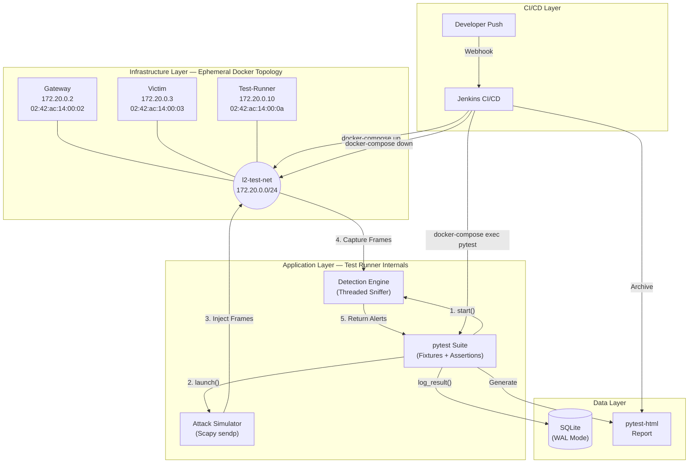
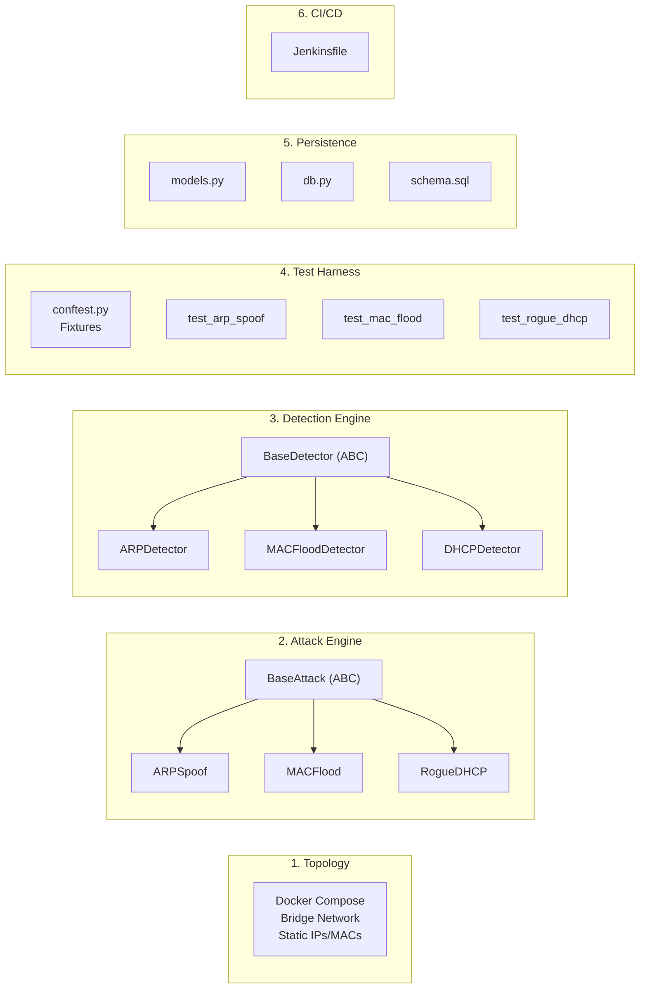
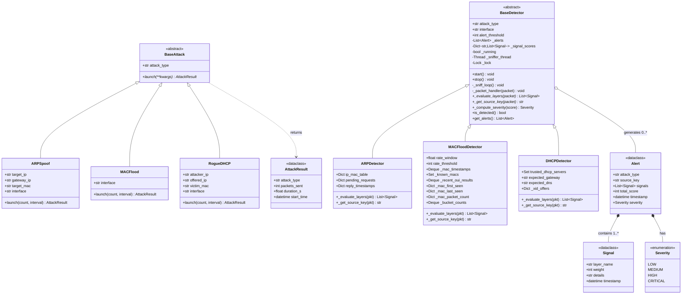
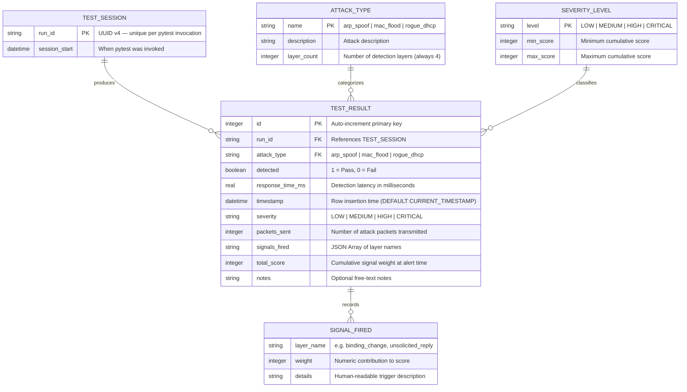
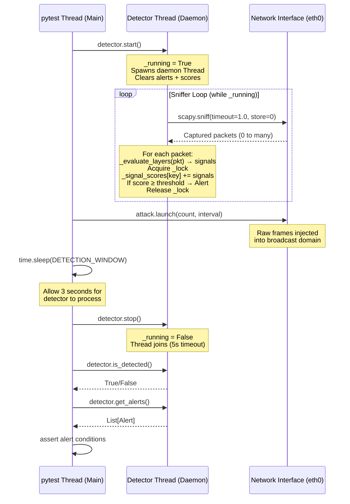
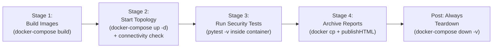

# 🛡️ SecureSystem — The Complete Interview Preparation Guide

> **One-liner pitch:** _"A continuous L2 network security regression testing pipeline that simulates Layer 2 attacks, detects them via multi-layered heuristic engines, and validates detection accuracy through automated CI/CD — all inside an ephemeral Docker topology."_

---

## Table of Contents

1. [Project Overview & Motivation](#1-project-overview--motivation)
2. [Tech Stack Deep Dive](#2-tech-stack-deep-dive)
3. [Repository Structure & File Map](#3-repository-structure--file-map)
4. [High-Level Design (HLD)](#4-high-level-design-hld)
5. [Low-Level Design (LLD)](#5-low-level-design-lld)
6. [ER Diagram & Database Schema](#6-er-diagram--database-schema)
7. [Complete Class & Function Reference](#7-complete-class--function-reference)
8. [File Interconnections & Dependency Graph](#8-file-interconnections--dependency-graph)
9. [Detection Algorithm Deep Dive](#9-detection-algorithm-deep-dive)
10. [Concurrency & Threading Model](#10-concurrency--threading-model)
11. [Docker Infrastructure](#11-docker-infrastructure)
12. [CI/CD Pipeline (Jenkins)](#12-cicd-pipeline-jenkins)
13. [Testing Strategy & Test Flow](#13-testing-strategy--test-flow)
14. [Data Flow — End-to-End Walkthrough](#14-data-flow--end-to-end-walkthrough)
15. [Design Patterns Used](#15-design-patterns-used)
16. [Interview Q&A — Likely Questions](#16-interview-qa--likely-questions)

---

## 1. Project Overview & Motivation

### What is this project?

This is a **Continuous L2 (Layer 2 / Data Link Layer) Network Security Validation Pipeline**. It addresses the fact that while DevSecOps pipelines routinely test application code, **network security defenses** (intrusion detection, firewall rules, L2 switch hardening) are **rarely regression-tested automatically**.

### What does it actually do?

```
Developer pushes code → Jenkins webhook fires → Docker topology spins up
→ Attacks launched via Scapy → Detectors sniff and analyze → pytest asserts detection
→ Results logged to SQLite → HTML report archived → Docker torn down
```

### Three core attacks simulated:

| Attack | OSI Layer | Protocol Exploited | Real-World Impact |
|---|---|---|---|
| **ARP Spoofing** | L2/L3 | ARP (no auth) | Man-in-the-Middle: redirect traffic through attacker |
| **MAC Flooding** | L2 | CAM table overflow | Switch fails open → hub mode → all traffic visible |
| **Rogue DHCP** | L2/L3 | DHCP (no server auth) | Attacker becomes victim's gateway + DNS |

### Why these attacks?

ARP, DHCP, and MAC learning are all **trust-based protocols with zero authentication**. Any device on the LAN can claim any identity. These are the most common real-world L2 threats encountered by network security engineers.

---

## 2. Tech Stack Deep Dive

### Core Technologies

| Technology | Version | Role in Project | Why This Specific Tool |
|---|---|---|---|
| **Python** | 3.11 | Primary language for all logic | Rich networking library ecosystem (Scapy), rapid prototyping |
| **Scapy** | ≥2.5.0 | Raw packet crafting + passive sniffing | Industry standard for packet manipulation; can craft ANY protocol header |
| **pytest** | ≥7.4.0 | Test automation framework | Fixtures, parametrize, plugins; industry standard for Python testing |
| **pytest-html** | ≥4.1.0 | HTML test report generation | Produces self-contained visual reports for Jenkins archiving |
| **SQLite** | Built-in | Test result persistence | Zero-config, WAL mode for concurrent writes, embedded in Python stdlib |
| **Docker** | Any modern | Container-based virtual L2 network | Provides isolated bridge network simulating a real L2 broadcast domain |
| **Docker Compose** | v3.8 | Multi-container orchestration | Defines the entire 3-node topology declaratively |
| **Jenkins** | Any modern | CI/CD pipeline orchestrator | Industry-standard for DevOps; webhook-driven automation |

### Key Python Standard Library Modules Used

| Module | Where Used | Purpose |
|---|---|---|
| `threading` | `detectors/base.py` | Background sniffer thread per detector |
| `collections.defaultdict` | All detectors, `db.py` | Default-initialized dictionaries for signal accumulation |
| `collections.deque` | All detectors | Bounded sliding windows for rate tracking |
| `abc.ABC, abstractmethod` | `attacks/base.py`, `detectors/base.py` | Enforcing abstract base class contracts |
| `dataclasses` | `common/models.py` | Clean data structures without boilerplate |
| `enum.Enum` | `common/models.py` | Type-safe severity levels |
| `sqlite3` | `common/db.py` | Database operations with WAL journaling |
| `json` | `common/db.py` | Serializing `signals_fired` list for storage |
| `uuid` | `tests/conftest.py` | Unique test session identifiers |
| `math` | `detectors/mac_flood_detector.py` | Standard deviation calculation for adaptive baseline |
| `time.monotonic()` | All attacks + detectors | High-precision monotonic clock for latency measurement |

### Scapy Protocol Classes Used

| Scapy Class | Used In | What It Represents |
|---|---|---|
| `Ether` | All attacks + detectors | Ethernet (L2) frame header — `src`, `dst` MAC addresses |
| `ARP` | ARP spoof + flood attacks/detectors | ARP packet — `op` (request/reply), `psrc`, `pdst`, `hwsrc`, `hwdst` |
| `IP` | Rogue DHCP attack/detector | IPv4 header — `src`, `dst` IP addresses |
| `UDP` | Rogue DHCP attack | UDP header — `sport=67` (server), `dport=68` (client) |
| `BOOTP` | Rogue DHCP attack/detector | Bootstrap Protocol — `op`, `yiaddr`, `siaddr`, `xid` |
| `DHCP` | Rogue DHCP attack/detector | DHCP options layer — option tuples like `("router", "x.x.x.x")` |
| `RandMAC()` | MAC flood attack | Generates a random MAC address per packet |
| `RandIP()` | MAC flood attack | Generates a random IP address per packet |
| `RandInt()` | Rogue DHCP attack | Generates a random 32-bit transaction ID |
| `sendp()` | All attacks | Sends packets at Layer 2 (raw Ethernet frames) |
| `sniff()` | `detectors/base.py` | Passive packet capture with callback |
| `getmacbyip()` | ARP spoof attack | Resolves IP → MAC via ARP resolution |

---

## 3. Repository Structure & File Map

```
SecureSystem/
├── attacks/                          # 🗡️ ATTACK SIMULATION ENGINE
│   ├── __init__.py                   #   Package marker
│   ├── base.py                       #   Abstract BaseAttack class
│   ├── arp_spoof.py                  #   ARPSpoof → sends gratuitous ARP replies
│   ├── mac_flood.py                  #   MACFlood → random MAC frame flooding
│   └── rogue_dhcp.py                 #   RogueDHCP → forged DHCP OFFER injection
│
├── detectors/                        # 🛡️ MULTI-LAYER DETECTION ENGINE
│   ├── __init__.py                   #   Package marker
│   ├── base.py                       #   Abstract BaseDetector (thread mgmt, scoring)
│   ├── arp_detector.py               #   ARPDetector → 4-layer ARP spoof detection
│   ├── mac_flood_detector.py         #   MACFloodDetector → 4-layer flood detection
│   ├── dhcp_detector.py              #   DHCPDetector → 4-layer rogue DHCP detection
│   └── oui_data.py                   #   VALID_OUIS set + is_valid_oui() helper
│
├── common/                           # 🔧 SHARED FRAMEWORK
│   ├── __init__.py                   #   Package marker
│   ├── models.py                     #   Severity enum, Signal, Alert, AttackResult dataclasses
│   └── db.py                         #   SQLite helpers: init_db(), log_result(), get_results()
│
├── tests/                            # 🧪 AUTOMATED TEST SUITE
│   ├── __init__.py                   #   Package marker
│   ├── conftest.py                   #   Pytest fixtures: network_config, db_path, run_id, log_test_result
│   ├── test_arp_spoof.py             #   4 test cases for ARP spoof detection
│   ├── test_mac_flood.py             #   3 test cases for MAC flood detection
│   └── test_rogue_dhcp.py            #   3 test cases for rogue DHCP detection
│
├── db/                               # 💾 DATABASE
│   ├── schema.sql                    #   DDL for test_results table + indexes
│   ├── results.db                    #   Production SQLite database (Docker runs)
│   └── demo_results.db               #   Local demo database (demo.py)
│
├── docker/                           # 🐳 INFRASTRUCTURE
│   ├── docker-compose.yml            #   3-service topology: gateway, victim, test-runner
│   ├── Dockerfile.gateway            #   Gateway container (ip_forward=1)
│   ├── Dockerfile.victim             #   Victim container (minimal)
│   └── Dockerfile.test-runner        #   Test runner (Python 3.11 + Scapy + pytest)
│
├── reports/                          # 📊 TEST REPORTS
│   └── report.html                   #   pytest-html generated report
│
├── demo.py                           #   🎮 Standalone local demo (no Docker needed)
├── Jenkinsfile                       #   🔄 CI/CD pipeline definition
├── pytest.ini                        #   ⚙️ Pytest configuration
├── requirements.txt                  #   📦 Python dependencies
├── README.md                         #   📖 Project documentation (HLD + LLD)
├── SIMULATION.md                     #   🖥️ Interactive simulation guide
└── l2-security-pipeline-brief.md     #   📝 Project design brief
```

### File Count & Size

| Category | Files | Total Lines | Purpose |
|---|---|---|---|
| Attack modules | 4 | ~200 | Offensive packet crafting |
| Detector modules | 5 | ~700 | Defensive heuristic analysis |
| Common/shared | 3 | ~193 | Data models + DB layer |
| Tests | 4 | ~355 | Automated validation |
| Docker config | 4 | ~95 | Infrastructure |
| CI/CD + Config | 3 | ~80 | Pipeline + settings |
| Documentation | 3 | ~900 | README, simulation, brief |
| Demo | 1 | ~215 | Local demonstration |
| **Total** | **27** | **~2,738** | |

---

## 4. High-Level Design (HLD)

### 4.1 System Architecture Diagram



### 4.2 Subsystem Decomposition

The system is decomposed into **6 subsystems**, each with a single responsibility:



### 4.3 Network Topology

| Container | IP Address | MAC Address | Role | Linux Capabilities |
|---|---|---|---|---|
| `l2-gateway` | `172.20.0.2` | `02:42:ac:14:00:02` | Default router (ip_forward=1) | `NET_ADMIN`, `NET_RAW` |
| `l2-victim` | `172.20.0.3` | `02:42:ac:14:00:03` | Target host | `NET_ADMIN`, `NET_RAW` |
| `l2-test-runner` | `172.20.0.10` | `02:42:ac:14:00:0a` | Attacker + detector + pytest | `NET_ADMIN`, `NET_RAW` |

> **Why static MACs?** Deterministic testing requires known identities. If MACs were DHCP-assigned, the detectors' trusted bindings would need dynamic discovery — adding complexity without security value.

---

## 5. Low-Level Design (LLD)

### 5.1 Complete Class Hierarchy



### 5.2 Severity Scoring Matrix

| Cumulative Score | Severity Level | Meaning |
|---|---|---|
| `score < 2` | `LOW` | Single weak signal — likely noise |
| `2 ≤ score < 4` | `MEDIUM` | Two weak or one moderate signal |
| `4 ≤ score < 6` | `HIGH` | Multiple layer convergence — likely attack |
| `score ≥ 6` | `CRITICAL` | Strong multi-layer agreement — confirmed attack |

---

## 6. ER Diagram & Database Schema

### 6.1 Entity-Relationship Diagram



### 6.2 Physical Database Schema (SQLite)

```sql
-- Table: test_results
-- One row per test execution (attack launched → detection checked)
CREATE TABLE IF NOT EXISTS test_results (
    id              INTEGER PRIMARY KEY AUTOINCREMENT,   -- Surrogate key
    run_id          TEXT NOT NULL,                        -- UUID per pytest session
    attack_type     TEXT NOT NULL,                        -- 'arp_spoof' | 'mac_flood' | 'rogue_dhcp'
    detected        BOOLEAN NOT NULL,                    -- 1 (Pass) | 0 (Fail)
    response_time_ms REAL,                               -- Detection latency (ms)
    timestamp       DATETIME DEFAULT CURRENT_TIMESTAMP,  -- Auto-filled insertion time
    severity        TEXT DEFAULT 'HIGH',                  -- LOW | MEDIUM | HIGH | CRITICAL
    packets_sent    INTEGER,                             -- Attack frame count
    signals_fired   TEXT,                                -- JSON array: ["binding_change", ...]
    total_score     INTEGER,                             -- Sum of signal weights
    notes           TEXT                                  -- Optional notes
);

-- Indexes for query performance
CREATE INDEX IF NOT EXISTS idx_run_id ON test_results(run_id);         -- Filter by session
CREATE INDEX IF NOT EXISTS idx_attack_type ON test_results(attack_type); -- Filter by attack
```

### 6.3 Column Relationships & Constraints

| Column | Type | Nullable | Source in Code |
|---|---|---|---|
| `id` | INTEGER PK | No | Auto-increment |
| `run_id` | TEXT | No | `uuid.uuid4()` from `conftest.py` |
| `attack_type` | TEXT | No | `BaseAttack.attack_type` / `BaseDetector.attack_type` |
| `detected` | BOOLEAN | No | `BaseDetector.is_detected()` |
| `response_time_ms` | REAL | Yes | `(time.monotonic() - start) * 1000` in test |
| `timestamp` | DATETIME | No | SQLite `CURRENT_TIMESTAMP` |
| `severity` | TEXT | No | `Alert.severity.value` → `Severity` enum |
| `packets_sent` | INTEGER | Yes | `AttackResult.packets_sent` |
| `signals_fired` | TEXT (JSON) | Yes | `json.dumps([s.layer_name for s in alert.signals])` |
| `total_score` | INTEGER | Yes | `Alert.total_score` |
| `notes` | TEXT | Yes | Free-text |

### 6.4 Database Operations

| Function | File | SQL Operation | Purpose |
|---|---|---|---|
| `init_db(db_path)` | `common/db.py` | `PRAGMA journal_mode=WAL` + `CREATE TABLE` | Initialize schema + enable WAL |
| `log_result(...)` | `common/db.py` | `INSERT INTO test_results` | Write one test result row |
| `get_results(db_path, run_id?)` | `common/db.py` | `SELECT * FROM test_results` | Query results (optionally by run) |

> **Why WAL mode?** Write-Ahead Logging allows concurrent readers + writer without blocking. In Docker, the sniffer thread and test thread could potentially interact with the DB simultaneously.

---

## 7. Complete Class & Function Reference

### 7.1 `common/models.py` — Core Data Structures

| Name | Type | Fields | Used By |
|---|---|---|---|
| `Severity` | Enum | `LOW`, `MEDIUM`, `HIGH`, `CRITICAL` | `BaseDetector._compute_severity()`, test assertions |
| `Signal` | @dataclass | `layer_name: str`, `weight: int`, `details: str`, `timestamp: datetime` | All detector `_evaluate_layers()` methods |
| `Alert` | @dataclass | `attack_type: str`, `source_key: str`, `signals: List[Signal]`, `total_score: int`, `timestamp: datetime`, `severity: Severity` | `BaseDetector._packet_handler()` |
| `AttackResult` | @dataclass | `attack_type: str`, `packets_sent: int`, `duration_s: float`, `start_time: datetime` | All attack `launch()` methods |

### 7.2 `common/db.py` — Database Layer

| Function | Signature | What It Does |
|---|---|---|
| `init_db` | `(db_path: str) → None` | Creates directory + DB file, enables WAL, runs schema DDL |
| `log_result` | `(db_path, run_id, attack_type, detected, response_time_ms?, severity?, packets_sent?, signals_fired?, total_score?, notes?) → None` | Inserts one result row. Converts `signals_fired` list to JSON string |
| `get_results` | `(db_path: str, run_id: str = None) → List[Dict]` | Returns all rows (or filtered by run_id) as list of dicts using `sqlite3.Row` |

### 7.3 `attacks/base.py` — Attack Base Class

| Class | Method | Signature | Description |
|---|---|---|---|
| `BaseAttack` (ABC) | `launch` | `(**kwargs) → AttackResult` | **Abstract.** Subclasses implement the actual packet transmission |
| | `attack_type` | `str = "unknown"` | Class attribute overridden by each subclass |

### 7.4 `attacks/arp_spoof.py` — ARP Spoofing Attack

| Method | Signature | What It Does |
|---|---|---|
| `__init__` | `(target_ip, gateway_ip, target_mac=None, interface="eth0")` | Stores target/gateway IPs and MACs |
| `launch` | `(count=10, interval=0.1) → AttackResult` | Resolves target MAC if needed → crafts `Ether/ARP(op=2)` with `psrc=gateway_ip` → calls `sendp()` → returns metadata |

**Key detail:** `hwsrc` is intentionally omitted in the ARP payload, so Scapy defaults to the attacker's real MAC. This means `Ether.src` (attacker MAC) will **match** `ARP.hwsrc` (also attacker MAC), so the L3 Header Mismatch layer in the detector will NOT fire for this attack — but L1 (binding change) and L2 (unsolicited reply) WILL.

### 7.5 `attacks/mac_flood.py` — MAC Flooding Attack

| Method | Signature | What It Does |
|---|---|---|
| `__init__` | `(interface="eth0")` | Stores interface name |
| `launch` | `(count=500, interval=0.001) → AttackResult` | Crafts `Ether(src=RandMAC(), dst=broadcast)/ARP(op=1, psrc=RandIP(), pdst=RandIP())` → sends at 1000 pps → returns metadata |

**Key detail:** `RandMAC()` in the Ether `src` generates a new random MAC per packet. Since `RandMAC()` is in the Ether constructor, Scapy regenerates it for each of the `count` packets sent.

### 7.6 `attacks/rogue_dhcp.py` — Rogue DHCP Server Attack

| Method | Signature | What It Does |
|---|---|---|
| `__init__` | `(attacker_ip, offered_ip="172.20.0.100", victim_mac="ff:ff:ff:ff:ff:ff", interface="eth0")` | Stores attacker/victim identities |
| `launch` | `(count=5, interval=0.2) → AttackResult` | Crafts `Ether/IP/UDP(67→68)/BOOTP(op=2)/DHCP(offer)` with `router=attacker_ip`, `name_server=attacker_ip` → sends → returns metadata |

**Key packet structure (bottom-up):**
```
Ether(dst=victim_mac)                    ← L2 frame targeting victim
  └── IP(src=attacker, dst=broadcast)    ← L3 from attacker to broadcast
      └── UDP(sport=67, dport=68)        ← DHCP ports (server→client)
          └── BOOTP(op=2, yiaddr=...)    ← Boot Reply with offered IP
              └── DHCP(options=[...])     ← Rogue gateway + DNS + lease
```

### 7.7 `detectors/base.py` — Detection Engine Base Class

| Method | Signature | Description |
|---|---|---|
| `__init__` | `(interface="eth0", alert_threshold=3)` | Initializes thread state, lock, empty alerts/scores |
| `start()` | `→ None` | Sets `_running=True`, clears state, spawns daemon `_sniff_loop` thread |
| `stop()` | `→ None` | Sets `_running=False`, joins thread with 5s timeout |
| `_sniff_loop()` | `→ None` (private) | While `_running`: `sniff(timeout=1)` → calls `_packet_handler` per packet |
| `_packet_handler(pkt)` | `→ None` (private) | Calls `_evaluate_layers(pkt)` → if signals, accumulates per source_key → if score ≥ threshold, creates `Alert`, resets source score |
| `_evaluate_layers(pkt)` | `→ List[Signal]` (**abstract**) | Subclass implements: run all heuristic layers, return fired signals |
| `_get_source_key(pkt)` | `→ str` (**abstract**) | Subclass implements: extract the identity key from the packet |
| `_compute_severity(score)` | `→ Severity` | Maps score → LOW/MEDIUM/HIGH/CRITICAL |
| `is_detected()` | `→ bool` | Returns `len(self._alerts) > 0` |
| `get_alerts()` | `→ List[Alert]` | Returns copy of all accumulated alerts |

### 7.8 `detectors/arp_detector.py` — ARP Spoofing Detector

| Layer | Name | Weight | Trigger Condition |
|---|---|---|---|
| L1 | `binding_change` | 2 | Known IP's MAC changes from stored value |
| L2 | `unsolicited_reply` | 2 | ARP reply with no matching prior request (5s TTL) |
| L3 | `header_mismatch` | 3 | `Ether.src ≠ ARP.hwsrc` (crafting artifact) |
| L4 | `reply_rate_anomaly` | 1 | >5 replies from same IP in 10s window |

| Data Structure | Type | Purpose |
|---|---|---|
| `ip_mac_table` | `Dict[str, str]` | IP → MAC binding history. Seeded with trusted bindings |
| `pending_requests` | `Dict[str, float]` | Tracks ARP requests: target_ip → monotonic timestamp |
| `reply_timestamps` | `Dict[str, deque(maxlen=100)]` | Per-IP ARP reply timestamps for rate tracking |

### 7.9 `detectors/mac_flood_detector.py` — MAC Flood Detector

| Layer | Name | Weight | Trigger Condition |
|---|---|---|---|
| L1 | `unique_mac_rate` | 2 | >50 unique MACs observed in 10s sliding window |
| L2 | `invalid_oui` | 2 | >30% of last 100 MACs have unregistered OUI prefixes |
| L3 | `mac_churn` | 2 | >50% of known MACs are "ephemeral" (seen once, >5s old). Evaluated every 50 new MACs |
| L4 | `adaptive_baseline` | 1 | Current bucket rate > μ + 3σ of historical buckets. Needs ≥3 historical buckets |

| Data Structure | Type | Purpose |
|---|---|---|
| `_mac_timestamps` | `Deque[(float, str)]` | Sliding window of (timestamp, MAC) for L1 |
| `_known_macs` | `Set[str]` | All unique MACs ever seen |
| `_recent_oui_results` | `Deque[bool](maxlen=100)` | Rolling OUI validity for L2 |
| `_mac_first_seen` | `Dict[str, float]` | When each MAC was first observed |
| `_mac_last_seen` | `Dict[str, float]` | When each MAC was last observed |
| `_mac_packet_count` | `Dict[str, int]` | Packet count per MAC for churn analysis |
| `_bucket_counts` | `Deque[int](maxlen=6)` | Historical time-bucket MAC ingress rates for L4 |

### 7.10 `detectors/dhcp_detector.py` — Rogue DHCP Detector

| Layer | Name | Weight | Trigger Condition |
|---|---|---|---|
| L1 | `untrusted_server` | 3 | Source MAC AND IP not in `trusted_dhcp_servers` set |
| L2 | `duplicate_offer` | 2 | >1 DHCP OFFER for same BOOTP transaction ID (xid) |
| L3 | `param_anomaly` | 2 | Offered router ≠ expected gateway OR offered DNS ≠ expected DNS |
| L4 | `dhcp_fingerprint` | 1 | DHCP option ordering doesn't match ISC-DHCPD, dnsmasq, or Windows DHCP signatures |

| Data Structure | Type | Purpose |
|---|---|---|
| `trusted_dhcp_servers` | `Set[str]` | Allowlisted server MACs and/or IPs |
| `expected_gateway` | `str` | Known-good gateway IP |
| `expected_dns` | `str` | Known-good DNS IP |
| `_xid_offers` | `Dict[int, int]` | Transaction ID → offer count for L2 |

**Helper functions:**
- `_get_dhcp_option(options, name)` → Extracts a DHCP option value by name from Scapy's options list
- `_get_dhcp_option_order(options)` → Extracts the numeric ordering of DHCP option codes (for fingerprinting)

**Known fingerprint signatures:**
```python
KNOWN_SERVER_FINGERPRINTS = {
    "isc_dhcpd":     [53, 54, 51, 1, 28, 3, 15, 6],
    "dnsmasq":       [53, 54, 51, 1, 3, 6, 28],
    "windows_dhcp":  [53, 54, 51, 1, 15, 3, 6, 44, 46],
}
```

### 7.11 `detectors/oui_data.py` — OUI Validation

| Name | Type | Description |
|---|---|---|
| `VALID_OUIS` | `Set[str]` (~200 entries) | Curated set of IEEE OUI prefixes from major vendors (Intel, Cisco, Dell, HP, Apple, Samsung, VMware, Docker, etc.) |
| `is_valid_oui(mac)` | `(str) → bool` | Extracts first 3 octets (`mac[:8]`), checks membership in `VALID_OUIS` |

### 7.12 `tests/conftest.py` — Test Fixtures

| Fixture | Scope | Returns | Purpose |
|---|---|---|---|
| `network_config` | session | `Dict` with IPs/MACs/interface | Network topology constants matching docker-compose |
| `db_path` | session | `str` (file path) | Initializes and returns SQLite DB path |
| `run_id` | session | `str` (UUID) | Unique test session identifier |
| `log_test_result` | per-test | `Callable` | Pre-fills `db_path` + `run_id` into `log_result()` |

**Constants:**
- `DETECTION_WINDOW = 3.0` seconds — sleep time after attack to allow detector processing
- `DB_PATH = "/app/db/results.db"` (or `L2_DB_PATH` env var)

### 7.13 `demo.py` — Standalone Demonstration

| Function | What It Does |
|---|---|
| `run_arp_spoof_demo()` | Creates ARPDetector with trusted bindings → crafts spoofed ARP packet → feeds directly to `_packet_handler()` 6 times → prints alerts → logs to DB |
| `run_mac_flood_demo()` | Creates MACFloodDetector → feeds 30 random-MAC packets to `_packet_handler()` → prints alerts → logs |
| `run_rogue_dhcp_demo()` | Creates DHCPDetector with trusted server → crafts rogue DHCP OFFER → feeds to `_packet_handler()` → prints alerts → logs |
| `verify_db()` | Queries `demo_results.db` for `run_id="demo-local-run"` → prints all results |

> **Key difference from tests:** `demo.py` bypasses the sniffer thread and calls `_packet_handler()` directly, so it runs on any machine without Docker or raw socket privileges.

---

## 8. File Interconnections & Dependency Graph

### 8.1 Import/Dependency Map

```mermaid
graph TD
    subgraph "common/"
        MODELS["models.py<br/>(Severity, Signal, Alert, AttackResult)"]
        DB["db.py<br/>(init_db, log_result, get_results)"]
    end

    subgraph "attacks/"
        A_BASE["base.py<br/>(BaseAttack ABC)"]
        A_ARP["arp_spoof.py<br/>(ARPSpoof)"]
        A_MAC["mac_flood.py<br/>(MACFlood)"]
        A_DHCP["rogue_dhcp.py<br/>(RogueDHCP)"]
    end

    subgraph "detectors/"
        D_BASE["base.py<br/>(BaseDetector ABC)"]
        D_ARP["arp_detector.py<br/>(ARPDetector)"]
        D_MAC["mac_flood_detector.py<br/>(MACFloodDetector)"]
        D_DHCP["dhcp_detector.py<br/>(DHCPDetector)"]
        OUI["oui_data.py<br/>(VALID_OUIS, is_valid_oui)"]
    end

    subgraph "tests/"
        CONF["conftest.py<br/>(Fixtures)"]
        T_ARP["test_arp_spoof.py"]
        T_MAC["test_mac_flood.py"]
        T_DHCP["test_rogue_dhcp.py"]
    end

    DEMO["demo.py"]

    %% common dependencies
    A_BASE -->|imports AttackResult| MODELS
    A_ARP -->|imports BaseAttack| A_BASE
    A_ARP -->|imports AttackResult| MODELS
    A_MAC -->|imports BaseAttack| A_BASE
    A_MAC -->|imports AttackResult| MODELS
    A_DHCP -->|imports BaseAttack| A_BASE
    A_DHCP -->|imports AttackResult| MODELS

    D_BASE -->|imports Signal, Alert, Severity| MODELS
    D_ARP -->|imports BaseDetector| D_BASE
    D_ARP -->|imports Signal| MODELS
    D_MAC -->|imports BaseDetector| D_BASE
    D_MAC -->|imports Signal| MODELS
    D_MAC -->|imports is_valid_oui| OUI
    D_DHCP -->|imports BaseDetector| D_BASE
    D_DHCP -->|imports Signal| MODELS

    CONF -->|imports init_db, log_result| DB
    T_ARP -->|imports ARPSpoof| A_ARP
    T_ARP -->|imports ARPDetector| D_ARP
    T_ARP -->|imports Severity| MODELS
    T_ARP -->|imports DETECTION_WINDOW| CONF
    T_MAC -->|imports MACFlood| A_MAC
    T_MAC -->|imports MACFloodDetector| D_MAC
    T_MAC -->|imports Severity| MODELS
    T_MAC -->|imports DETECTION_WINDOW| CONF
    T_DHCP -->|imports RogueDHCP| A_DHCP
    T_DHCP -->|imports DHCPDetector| D_DHCP
    T_DHCP -->|imports Severity| MODELS
    T_DHCP -->|imports DETECTION_WINDOW| CONF

    DEMO -->|imports all detectors| D_ARP
    DEMO -->|imports all detectors| D_MAC
    DEMO -->|imports all detectors| D_DHCP
    DEMO -->|imports Severity| MODELS
    DEMO -->|imports init_db, log_result, get_results| DB
```



### 8.2 Cross-Reference Table

| File | Imports From | Imported By |
|---|---|---|
| `common/models.py` | `dataclasses`, `datetime`, `enum` (stdlib) | Every attack, detector, test, and demo file |
| `common/db.py` | `json`, `os`, `sqlite3` (stdlib) | `tests/conftest.py`, `demo.py` |
| `attacks/base.py` | `common.models.AttackResult` | `arp_spoof.py`, `mac_flood.py`, `rogue_dhcp.py` |
| `attacks/arp_spoof.py` | `attacks.base.BaseAttack`, `common.models.AttackResult`, `scapy` | `tests/test_arp_spoof.py` |
| `attacks/mac_flood.py` | `attacks.base.BaseAttack`, `common.models.AttackResult`, `scapy` | `tests/test_mac_flood.py` |
| `attacks/rogue_dhcp.py` | `attacks.base.BaseAttack`, `common.models.AttackResult`, `scapy` | `tests/test_rogue_dhcp.py` |
| `detectors/base.py` | `common.models.Alert/Signal/Severity`, `scapy.sniff`, `threading` | `arp_detector.py`, `mac_flood_detector.py`, `dhcp_detector.py` |
| `detectors/arp_detector.py` | `detectors.base.BaseDetector`, `common.models.Signal`, `scapy` | `tests/test_arp_spoof.py`, `demo.py` |
| `detectors/mac_flood_detector.py` | `detectors.base.BaseDetector`, `common.models.Signal`, `detectors.oui_data`, `scapy` | `tests/test_mac_flood.py`, `demo.py` |
| `detectors/dhcp_detector.py` | `detectors.base.BaseDetector`, `common.models.Signal`, `scapy` | `tests/test_rogue_dhcp.py`, `demo.py` |
| `detectors/oui_data.py` | None (standalone) | `mac_flood_detector.py` |
| `tests/conftest.py` | `common.db` | All test files (fixtures auto-injected by pytest) |
| `demo.py` | All detectors, `common.db`, `common.models`, `scapy` | None (entry point) |

---

## 9. Detection Algorithm Deep Dive

### 9.1 ARP Spoofing Detection — All 4 Layers

```
Packet arrives → Is it ARP? → No → Ignore
                              ↓ Yes
                   Is it op=1 (Request)?
                              ↓ Yes → Store pending_requests[pdst] = now → Return []
                              ↓ No (op=2, Reply)
                   ┌──────────────────────────┐
                   │ L1: BINDING CHANGE (w=2)  │
                   │ ip_mac_table[psrc] exists? │
                   │   Yes + MAC changed? → ⚡  │
                   │ Update table regardless    │
                   └──────────────────────────┘
                   ┌──────────────────────────┐
                   │ L2: UNSOLICITED REPLY(w=2)│
                   │ Evict stale requests >5s  │
                   │ psrc in pending_requests? │
                   │   No → ⚡ (unsolicited)   │
                   │   Yes → consume match     │
                   └──────────────────────────┘
                   ┌──────────────────────────┐
                   │ L3: HEADER MISMATCH (w=3) │
                   │ Ether.src ≠ ARP.hwsrc?   │
                   │   Yes → ⚡               │
                   └──────────────────────────┘
                   ┌──────────────────────────┐
                   │ L4: RATE ANOMALY (w=1)    │
                   │ Count replies from psrc   │
                   │   in last 10s             │
                   │   >5 → ⚡                │
                   └──────────────────────────┘
                   Return list of ⚡ Signals
```

### 9.2 MAC Flood Detection — All 4 Layers

```
Packet arrives → Has Ether layer? → No → Ignore
                                    ↓ Yes
                   Extract src_mac, check if new (not in _known_macs)
                   ┌──────────────────────────────┐
                   │ L1: UNIQUE MAC RATE (w=2)     │
                   │ If new: add to sliding window │
                   │ Evict entries >10s old         │
                   │ Count unique MACs in window    │
                   │   >50 → ⚡                    │
                   └──────────────────────────────┘
                   ┌──────────────────────────────┐
                   │ L2: INVALID OUI (w=2)         │
                   │ If new: check is_valid_oui()  │
                   │ Track last 100 results         │
                   │ If ≥20 checked:                │
                   │   Invalid% >30% → ⚡          │
                   └──────────────────────────────┘
                   ┌──────────────────────────────┐
                   │ L3: MAC CHURN (w=2)            │
                   │ Track per-MAC packet count     │
                   │ Every 50th new MAC:            │
                   │   Count MACs seen exactly once │
                   │   and older than 5s             │
                   │   Ratio >50% → ⚡             │
                   └──────────────────────────────┘
                   ┌──────────────────────────────┐
                   │ L4: ADAPTIVE BASELINE (w=1)    │
                   │ Track new MACs per time bucket │
                   │ Every bucket_duration seconds:  │
                   │   Compute μ and σ of history   │
                   │   Current > μ + 3σ → ⚡       │
                   └──────────────────────────────┘
```

### 9.3 Rogue DHCP Detection — All 4 Layers

```
Packet arrives → Is DHCP OFFER? → No → Ignore
                                   ↓ Yes
                   ┌──────────────────────────────┐
                   │ L1: UNTRUSTED SERVER (w=3)    │
                   │ src_mac NOT in trusted set    │
                   │ AND src_ip NOT in trusted set │
                   │   Both miss → ⚡             │
                   └──────────────────────────────┘
                   ┌──────────────────────────────┐
                   │ L2: DUPLICATE OFFER (w=2)     │
                   │ Track offers per BOOTP xid    │
                   │ xid_offers[xid] > 1 → ⚡     │
                   └──────────────────────────────┘
                   ┌──────────────────────────────┐
                   │ L3: PARAM ANOMALY (w=2)       │
                   │ Extract DHCP option 3 (router)│
                   │ Extract DHCP option 6 (DNS)   │
                   │ Router ≠ expected → ⚡        │
                   │ DNS ≠ expected → ⚡           │
                   └──────────────────────────────┘
                   ┌──────────────────────────────┐
                   │ L4: FINGERPRINT (w=1)         │
                   │ Extract DHCP option ordering   │
                   │ Compare vs known server sigs   │
                   │ No prefix match → ⚡          │
                   └──────────────────────────────┘
```

---

## 10. Concurrency & Threading Model

### 10.1 Thread Lifecycle



### 10.2 Thread Safety Mechanism

| Resource | Protected By | Access Pattern |
|---|---|---|
| `_signal_scores` (Dict) | `threading.Lock` | Detector thread writes, main thread reads after stop |
| `_alerts` (List) | `threading.Lock` | Detector thread appends, main thread reads after stop |
| `_running` (bool) | Atomic in CPython (GIL) | Main thread writes, detector thread reads |

> **Important:** The `_lock` is acquired inside `_packet_handler()` for the critical section where scores are accumulated and alerts are generated. This prevents data corruption if packets arrive during the short `sniff(timeout=1)` gap between bursts.

### 10.3 Why `sniff(timeout=1)` instead of indefinite sniffing?

Without a timeout, `scapy.sniff()` blocks forever on quiet networks. The 1-second timeout creates a natural "heartbeat" where the loop can check `self._running` and exit cleanly when `stop()` is called. This is the standard pattern for cooperative thread shutdown in Python.

---

## 11. Docker Infrastructure

### 11.1 Container Architecture

```
┌─────────────────── Docker Bridge: l2-test-net (172.20.0.0/24) ────────────────────┐
│                                                                                      │
│  ┌──────────────────┐  ┌──────────────────┐  ┌────────────────────────────────┐    │
│  │  l2-gateway       │  │  l2-victim        │  │  l2-test-runner                │    │
│  │  IP: 172.20.0.2   │  │  IP: 172.20.0.3   │  │  IP: 172.20.0.10               │    │
│  │  MAC: 02:42:...02 │  │  MAC: 02:42:...03 │  │  MAC: 02:42:...0a               │    │
│  │                    │  │                    │  │                                  │    │
│  │  Capabilities:     │  │  Capabilities:     │  │  Capabilities:                  │    │
│  │  - NET_ADMIN       │  │  - NET_ADMIN       │  │  - NET_ADMIN                    │    │
│  │  - NET_RAW         │  │  - NET_RAW         │  │  - NET_RAW                      │    │
│  │                    │  │                    │  │                                  │    │
│  │  Sysctls:          │  │  Image:            │  │  Volume: ../:/app               │    │
│  │  ip_forward=1      │  │  python:3.11-slim  │  │  Installs: scapy, pytest,       │    │
│  │                    │  │  + iputils-ping     │  │  tcpdump, iproute2              │    │
│  │  Image:            │  │  + iproute2         │  │                                  │    │
│  │  python:3.11-slim  │  │                    │  │  Working Dir: /app               │    │
│  │  + iproute2        │  │                    │  │  Depends on: gateway, victim     │    │
│  │  + iputils-ping    │  │  Cmd: tail -f      │  │                                  │    │
│  │  + net-tools       │  │  /dev/null          │  │  Cmd: tail -f /dev/null          │    │
│  └──────────────────┘  └──────────────────┘  └────────────────────────────────┘    │
│                                                                                      │
└──────────────────────────────────────────────────────────────────────────────────────┘
```

### 11.2 Why These Specific Linux Capabilities?

| Capability | What It Allows | Why Needed |
|---|---|---|
| `NET_ADMIN` | Modify network configuration (routes, interfaces, ARP tables) | Required for ARP table manipulation and interface config |
| `NET_RAW` | Use raw sockets (send/receive arbitrary L2 frames) | Required by Scapy's `sendp()` and `sniff()` functions |

### 11.3 Dockerfile Build Chain

```
Dockerfile.gateway ──build──> l2-gateway container
  └── FROM python:3.11-slim
  └── apt install: iproute2, iputils-ping, net-tools

Dockerfile.victim ──build──> l2-victim container
  └── FROM python:3.11-slim
  └── apt install: iproute2, iputils-ping

Dockerfile.test-runner ──build──> l2-test-runner container
  └── FROM python:3.11-slim
  └── apt install: iproute2, iputils-ping, net-tools, tcpdump
  └── pip install: scapy, pytest, pytest-html
  └── Volume mount: entire project → /app
```

---

## 12. CI/CD Pipeline (Jenkins)

### 12.1 Pipeline Stages



### 12.2 Stage Details

| Stage | Command(s) | Failure Behavior |
|---|---|---|
| **Build Images** | `docker-compose build --no-cache` | Pipeline fails immediately |
| **Start Topology** | `docker-compose up -d` + `sleep 5` + `ping -c 3` (gateway & victim) | Pipeline fails if containers can't communicate |
| **Run Security Tests** | `docker-compose exec -T test-runner pytest -v` | Pipeline fails if any test assertion fails |
| **Archive Reports** | `docker cp` HTML report + SQLite DB → `publishHTML` in Jenkins UI | `|| true` allows graceful failure (reports may not exist) |
| **Post: Always** | `docker-compose down -v` | **Always** runs, even if tests fail → guarantees teardown |
| **Post: Success** | Echo ✅ message | Informational |
| **Post: Failure** | Echo ❌ message | Informational |

### 12.3 Jenkins ↔ GitHub Webhook Flow

```
Developer → git push → GitHub → HTTP POST /github-webhook/ → Jenkins
Jenkins → Checkout Jenkinsfile → Execute pipeline stages
Jenkins → POST GitHub Commit Status API → Green ✓ or Red ✗ on commit
```

---

## 13. Testing Strategy & Test Flow

### 13.1 Test Case Matrix

| Test File | Test Class | Test Method | What It Validates |
|---|---|---|---|
| `test_arp_spoof.py` | `TestARPSpoofDetection` | `test_arp_spoof_detected` | Attack IS detected, alerts exist |
| | | `test_arp_spoof_multi_layer_convergence` | ≥2 distinct detection layers fire |
| | | `test_arp_spoof_response_time` | Detection completes in <5000ms |
| | | `test_arp_spoof_severity` | Alert severity is HIGH or CRITICAL |
| `test_mac_flood.py` | `TestMACFloodDetection` | `test_mac_flood_detected` | Attack IS detected |
| | | `test_mac_flood_oui_layer` | `invalid_oui` or `unique_mac_rate` layer fires |
| | | `test_mac_flood_severity_critical` | Severity is HIGH or CRITICAL (300 packets) |
| `test_rogue_dhcp.py` | `TestRogueDHCPDetection` | `test_rogue_dhcp_detected` | Attack IS detected |
| | | `test_rogue_dhcp_param_anomaly` | `param_anomaly` or `untrusted_server` layer fires |
| | | `test_rogue_dhcp_severity` | Severity is HIGH or CRITICAL |

### 13.2 Test Lifecycle (Every Test)

```
1. Create Detector(interface, threshold, trusted_config)
2. detector.start()              ← Spawns sniffer thread
3. Create Attack(target, gateway, interface)
4. start_time = monotonic()
5. attack.launch(count, interval) ← Injects packets onto network
6. sleep(DETECTION_WINDOW=3.0)    ← Wait for sniffer to process
7. detector.stop()                ← Kills sniffer thread
8. elapsed_ms = (monotonic() - start_time) * 1000
9. detected = detector.is_detected()
10. alerts = detector.get_alerts()
11. log_test_result(...)          ← Write to SQLite
12. assert detected == True
13. assert specific_layers_fired
14. assert severity in {HIGH, CRITICAL}
```

### 13.3 Attack Parameters Used in Tests

| Attack | `count` | `interval` | Total Packets | Rationale |
|---|---|---|---|---|
| ARP Spoof | 10 | 0.1s | 10 | Enough to trigger binding_change + unsolicited_reply |
| MAC Flood | 200 (default), 300 (severity test) | 0.001s | 200-300 | Must exceed rate_threshold=50 |
| Rogue DHCP | 5 | 0.2s | 5 | Even 1 packet can trigger untrusted_server (w=3) |

---

## 14. Data Flow — End-to-End Walkthrough

### Example: ARP Spoof Test Execution

```
┌─ Step 1: pytest starts, conftest.py runs ──────────────────────────────────────┐
│ • uuid.uuid4() → run_id = "a3f2c1d4-..."                                       │
│ • init_db("/app/db/results.db") → Creates table if not exists, enables WAL     │
└────────────────────────────────────────────────────────────────────────────────┘
                                    ↓
┌─ Step 2: ARPDetector initialized ──────────────────────────────────────────────┐
│ • ip_mac_table = {"172.20.0.2": "02:42:ac:14:00:02"}  (trusted gateway)       │
│ • alert_threshold = 3                                                           │
│ • _alerts = [], _signal_scores = {}                                             │
└────────────────────────────────────────────────────────────────────────────────┘
                                    ↓
┌─ Step 3: detector.start() ─────────────────────────────────────────────────────┐
│ • _running = True                                                                │
│ • Daemon thread spawned → runs _sniff_loop() → scapy.sniff(timeout=1)          │
└────────────────────────────────────────────────────────────────────────────────┘
                                    ↓
┌─ Step 4: ARPSpoof.launch(count=10, interval=0.1) ─────────────────────────────┐
│ • Crafts: Ether(dst=victim_mac) / ARP(op=2, psrc=gateway_ip, pdst=victim_ip)  │
│ • sendp() transmits 10 packets at 100ms intervals                               │
│ • Returns: AttackResult(attack_type="arp_spoof", packets_sent=10, ...)          │
└────────────────────────────────────────────────────────────────────────────────┘
                                    ↓
┌─ Step 5: Detector thread captures packets ─────────────────────────────────────┐
│ For each of the 10 spoofed ARP replies:                                         │
│   • _packet_handler(pkt) called                                                  │
│   • _evaluate_layers(pkt):                                                       │
│     • L1: ip_mac_table["172.20.0.2"] == "02:42:ac:14:00:02"                     │
│            but ARP.hwsrc == attacker's MAC → BINDING CHANGE ⚡ (w=2)           │
│     • L2: No prior ARP request for 172.20.0.2 → UNSOLICITED REPLY ⚡ (w=2)    │
│     • L3: Ether.src matches ARP.hwsrc (both attacker) → No signal              │
│     • L4: First few replies → rate < 5/10s → No signal yet                      │
│   • Signals: [binding_change(2), unsolicited_reply(2)]                          │
│   • Total score: 4 ≥ threshold(3) → Alert raised!                               │
│     severity = _compute_severity(4) = HIGH                                       │
│   • _signal_scores["172.20.0.2"].clear() → reset for next alert                 │
└────────────────────────────────────────────────────────────────────────────────┘
                                    ↓
┌─ Step 6: sleep(3.0) then detector.stop() ──────────────────────────────────────┐
│ • Main thread sleeps 3 seconds                                                   │
│ • _running = False → sniffer loop exits after current sniff(timeout=1) returns │
│ • Thread joins within 5s timeout                                                 │
└────────────────────────────────────────────────────────────────────────────────┘
                                    ↓
┌─ Step 7: Assertions + DB logging ──────────────────────────────────────────────┐
│ • assert detector.is_detected() → True ✓                                        │
│ • log_result(run_id, "arp_spoof", detected=True, response_time_ms=3150.2,      │
│              severity="HIGH", packets_sent=10,                                   │
│              signals_fired=["binding_change", "unsolicited_reply"],              │
│              total_score=4)                                                       │
│ • INSERT INTO test_results VALUES(...)                                            │
└────────────────────────────────────────────────────────────────────────────────┘
```

---

## 15. Design Patterns Used

| Pattern | Where Applied | Benefit |
|---|---|---|
| **Template Method** | `BaseDetector._packet_handler()` calls abstract `_evaluate_layers()` and `_get_source_key()` | Common sniff→evaluate→score→alert logic; subclasses only define heuristics |
| **Abstract Base Class (ABC)** | `BaseAttack`, `BaseDetector` | Enforces interface contracts at class definition time |
| **Strategy Pattern** | Each detector's `_evaluate_layers()` implements a different detection strategy | Detectors are interchangeable and independently extensible |
| **Observer/Callback** | `scapy.sniff(prn=self._packet_handler)` | Packets trigger handler without polling |
| **Data Transfer Object (DTO)** | `Signal`, `Alert`, `AttackResult` dataclasses | Clean data boundaries between layers |
| **Fixture Injection** | pytest fixtures (`network_config`, `db_path`, `run_id`, `log_test_result`) | Dependency injection for test setup |
| **Factory Method** | `_compute_severity(score) → Severity` | Encapsulates severity creation logic |
| **Sliding Window** | `deque` with time-based eviction in all detectors | Memory-bounded rate tracking |
| **Write-Ahead Log (WAL)** | `PRAGMA journal_mode=WAL` | Concurrent DB access without locking |
| **Daemon Thread** | `threading.Thread(daemon=True)` for sniffer | Thread auto-terminates if main thread exits |

---

## 16. Interview Q&A — Likely Questions

### Architecture & Design

**Q: Why multi-layer detection instead of a single rule?**
> Single-rule detectors have high false positive rates. For example, a binding change alone could be a legitimate DHCP renewal. By requiring convergence from multiple independent heuristics (minimum cumulative weight ≥ threshold), we achieve higher detection confidence while reducing false positives. This mirrors how real IDS systems (Snort, Suricata) use multi-signature correlation.

**Q: Why use Scapy instead of libpcap or raw sockets directly?**
> Scapy provides a high-level abstraction for both crafting AND sniffing. It handles protocol dissection (ARP fields, DHCP options) automatically, supports `RandMAC()`/`RandIP()` for fuzzing, and works identically across Linux containers. Direct libpcap would require manual byte parsing.

**Q: Why SQLite instead of PostgreSQL?**
> SQLite is zero-config, embedded in Python's stdlib, and its WAL mode handles the concurrency needs of this project (single writer + concurrent readers). The data volume is small (10 rows per test run). PostgreSQL would be appropriate for Phase 2 if Grafana telemetry or multi-node parallel test runs are needed.

**Q: How does the system prevent false positives?**
> Three mechanisms: (1) **Multi-layer convergence** — single signals don't trigger alerts, only their sum; (2) **Weighted scoring** — more reliable signals (e.g., header mismatch, weight=3) contribute more than statistical signals (rate anomaly, weight=1); (3) **Thresholds are tuned** — e.g., rate anomaly needs >5 replies in 10s, OUI needs >30% invalid, churn needs >50% ephemeral.

**Q: What's the difference between `demo.py` and the actual tests?**
> `demo.py` calls `_packet_handler()` directly (bypassing the sniffer thread and real network), so it runs anywhere without Docker or root. Tests use `sendp()` to inject real packets onto the Docker bridge network and the sniffer thread to capture them — testing the full end-to-end path including Scapy's send/receive stack.

### Networking

**Q: Explain how ARP spoofing works at the packet level.**
> ARP is a stateless, trust-based protocol. When a host needs to resolve IP→MAC, it broadcasts an ARP request. The target responds with an ARP reply. But any host can send an unsolicited ARP reply claiming any IP→MAC binding, and receivers will trust it without verification. The attacker sends `ARP(op=2, psrc=gateway_ip, hwsrc=attacker_mac)`, which tells the victim "the gateway's MAC is MY MAC." The victim updates its ARP cache and routes traffic through the attacker.

**Q: Why does MAC flooding cause a switch to "fail open"?**
> Switches maintain a CAM (Content Addressable Memory) table mapping MAC addresses to physical ports. This table has a finite size (e.g., 8K-32K entries). When flooded with thousands of unique source MACs, the table overflows. Many switches handle this by broadcasting frames to all ports (hub behavior), allowing the attacker to sniff all traffic on the segment.

**Q: What's the significance of the DHCP fingerprint layer?**
> Legitimate DHCP servers (ISC-DHCPD, dnsmasq, Windows DHCP) have characteristic orderings of DHCP options in their OFFER packets. Scapy-crafted packets use a different ordering because the attacker specifies options manually rather than relying on a server implementation. By comparing option orderings against known signatures, we can distinguish real servers from crafted packets — even if the attacker puts the correct gateway/DNS values.

### CI/CD & Testing

**Q: Why use Docker for the test topology instead of mocking?**
> Mocking would test our Python logic but not the actual packet crafting and network-level behavior. By using a real Docker bridge network, we validate that Scapy-crafted frames actually reach the sniffer, that the Linux network stack handles them correctly, and that the timing/concurrency of real packet processing works. This is an integration test, not a unit test.

**Q: What happens if a test fails in Jenkins?**
> The pipeline enters the `post { failure }` block, which logs an error message. The `post { always }` block **still executes**, ensuring `docker-compose down -v` tears down the topology (no leaked containers). The HTML report is archived regardless (via `|| true` on the `docker cp` command), so the failure details are available in the Jenkins build artifacts.

**Q: How would you add a new attack type to this system?**
> 1. Create `attacks/new_attack.py` inheriting from `BaseAttack`, implement `launch()`.
> 2. Create `detectors/new_detector.py` inheriting from `BaseDetector`, implement `_evaluate_layers()` and `_get_source_key()`.
> 3. Create `tests/test_new_attack.py` following the existing pattern (create detector → launch attack → assert detection).
> 4. No changes needed to `BaseDetector`, `conftest.py`, `db.py`, or `Jenkinsfile` — the architecture is designed for extensibility via the Template Method pattern.

### Concurrency

**Q: Is there a race condition between the sniffer thread and the test thread?**
> No, by design. The test thread calls `stop()` which sets `_running=False` and joins the sniffer thread. After `stop()` returns, the sniffer thread is guaranteed to have exited. Only then does the test thread read `is_detected()` and `get_alerts()`. During active sniffing, the `_lock` protects `_signal_scores` and `_alerts` from concurrent mutation.

**Q: Why daemon thread instead of a regular thread?**
> If a test crashes or pytest is killed (SIGKILL), daemon threads are automatically terminated by the Python runtime. Without `daemon=True`, orphaned sniffer threads could keep the process alive indefinitely, which would hang the Jenkins build.

---

> **💡 Final tip:** When explaining this project in an interview, lead with the **problem it solves** (L2 defenses are never regression-tested), then the **architecture** (attack→detect→assert loop inside ephemeral Docker), then **one specific detection algorithm** in depth (ARP 4-layer is the easiest to explain with clear before/after ARP table states). Avoid describing it as "a script" — it's a **pipeline** with proper separation of concerns, CI/CD integration, and extensible OOP design.
